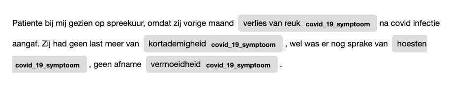

# clinlp

[](https://github.com/umcu/clinlp/actions/workflows/test.yml)
[](https://clinlp.readthedocs.io/en/latest/?badge=latest)
[](https://pypi.org/project/clinlp/)
[](https://pypi.org/project/clinlp/)
[](https://github.com/umcu/clinlp/blob/main/LICENSE)
[](https://spacy.io/)
[](https://github.com/astral-sh/ruff)


<!-- start_intro_line_1 -->
* :hospital: `clinical` + :netherlands: `nl` + :clipboard: `NLP` = :sparkles: `clinlp`
<!-- start_intro_line_2 -->
* :star: NLP tools and algorithms for clinical text written in Dutch
<!-- start_intro_line_3 -->
* :triangular_ruler: Organized in a standardized but flexible framework using `spaCy`
<!-- start_intro_line_4 -->
* :rocket: Production-ready, performant, well-tested and easy to use
<!-- start_intro_line_5 -->
* :bulb: Free, open source, created and maintained by the Dutch Clinical NLP community
<!-- end_intro_lines -->

## Contact

If you have questions, need help getting started, found a bug, or have a feature request, please don't hesitate to [contact us](https://clinlp.readthedocs.io/en/latest/contributing.html#contact)!

## Getting started

### Installation

```bash
pip install clinlp
```

If you use transformer-based components, install the optional dependency and
pre-download required model assets:

```bash
pip install "clinlp[transformers]"
clinlp install transformers
```

Use `--force-download` to refresh cached model files.

### Example

```python
import spacy
from clinlp.ie import Term

nlp = spacy.blank("clinlp")

# Normalization
nlp.add_pipe("clinlp_normalizer")

# Sentences
nlp.add_pipe("clinlp_sentencizer")

# Entities
terms = {
    "prematuriteit": [
        "preterm", "<p3", "prematuriteit", "partus praematurus"
    ],
    "hypotensie": [
        "hypotensie", Term("bd verlaagd", proximity=1)
    ],
    "veneus_infarct": [
        "veneus infarct", Term("VI", attr="TEXT")
    ]
}

entity_matcher = nlp.add_pipe("clinlp_rule_based_entity_matcher", config={"attr": "NORM", "fuzzy": 1})
entity_matcher.add_terms_from_dict(terms)

# Qualifiers
nlp.add_pipe("clinlp_context_algorithm", config={"phrase_matcher_attr": "NORM"})

text = (
    "Preterme neonaat (<p3) opgenomen, bd enigszins verlaagd, familieanamnese vermeldt eveneens hypotensie "
    "bij moeder. Thans geen aanwijzingen voor veneus infarkt wat ook geen "
    "verklaring voor de partus prematurus is. Risico op VI blijft aanwezig."
)

doc = nlp(text)
```

Find information in the `Doc` object:

```python
from spacy import displacy

displacy.render(doc, style="span", options={'spans_key': 'ents'})
```



With relevant qualifiers (defaults omitted for readability):

```python
for ent in doc.spans["ents"]:
  print(ent, ent._.qualifiers_str)
```

* `Preterme` `set()`
* `<p3` `set()`
* `bd enigszins verlaagd` `set()`
* `hypotensie` `{'Experiencer.Family'}`
* `veneus infarkt` `{'Presence.Absent'}`
* `partus prematurus` `set()`
* `VI` `{'Temporality.Future'}`

### PII and cardiology entity classification

The transformer-based `clinlp_pii_transformer` and `clinlp_cardioner_transformer`
components classify **existing entity spans** (they do not find new spans). They
add a `PII` qualifier (e.g. `NAME`, `LOCATION`, `DATE`) and a `MED_NER` qualifier
(`DISEASE`, `SYMPTOM`, `MEDICATION`, `PROCEDURE`), respectively, each defaulting
to `Absent`. Both require `clinlp[transformers]` (see [Installation](#installation)).

```python
import spacy

import clinlp  # noqa: F401

nlp = spacy.blank("clinlp")
nlp.add_pipe("clinlp_normalizer")
nlp.add_pipe("clinlp_sentencizer")

matcher = nlp.add_pipe("clinlp_rule_based_entity_matcher", config={"attr": "NORM"})
matcher.add_terms_from_dict(
    {
        "persoon": ["Jan Jansen"],
        "locatie": ["Utrecht"],
        "klacht": ["pijn op de borst", "palpitaties"],
        "ziekte": ["atriumfibrilleren"],
        "medicatie": ["metoprolol"],
        "verrichting": ["elektrische cardioversie"],
    }
)

nlp.add_pipe("clinlp_pii_transformer")
nlp.add_pipe("clinlp_cardioner_transformer")

doc = nlp(
    "Dhr. Jan Jansen uit Utrecht werd opgenomen wegens palpitaties en pijn op de "
    "borst. Op het ECG werd atriumfibrilleren gezien, waarvoor een elektrische "
    "cardioversie werd verricht. Bij ontslag gestart met metoprolol 50 mg."
)

for ent in doc.spans["ents"]:
    qualifiers = {q.name: q for q in ent._.qualifiers}
    pii, med = qualifiers["PII"], qualifiers["MED_NER"]
    print(
        f"{ent.text:<25} PII={pii.value:<9} ({pii.prob:.2f})  "
        f"MED_NER={med.value:<10} ({med.prob:.2f})"
    )
```

```text
Jan Jansen                PII=NAME      (1.00)  MED_NER=Absent     (1.00)
Utrecht                   PII=LOCATION  (1.00)  MED_NER=Absent     (1.00)
palpitaties               PII=Absent    (1.00)  MED_NER=SYMPTOM    (1.00)
pijn op de borst          PII=Absent    (1.00)  MED_NER=SYMPTOM    (1.00)
atriumfibrilleren         PII=Absent    (1.00)  MED_NER=DISEASE    (1.00)
elektrische cardioversie  PII=Absent    (1.00)  MED_NER=PROCEDURE  (1.00)
metoprolol                PII=Absent    (1.00)  MED_NER=MEDICATION (1.00)
```

The `prob` is the probability of the predicted class, averaged over the entity's
tokens (`B-`/`I-` and merged labels are summed per token). Predictions with
`prob <= proba_threshold` (default `0.1`) fall back to `Absent`. The PII component
merges fine-grained labels (e.g. `GIVENNAME`/`SURNAME` become `NAME`) by
default; pass `config={"reduce_labels": False}` to keep the original labels.

### Date association

The optional `clinlp_date_linker` component attaches potential dates to **existing
concept spans**. Add it after entity matching; it reads `doc.spans["ents"]` by
default and writes metadata to `span._.date`, without changing spans or qualifiers.

```python
import clinlp
import spacy

nlp = spacy.blank("clinlp")
matcher = nlp.add_pipe("clinlp_rule_based_entity_matcher")
matcher.add_terms_from_dict({"peritonitis": ["PD peritonitis"]})
nlp.add_pipe(
    "clinlp_date_linker",
    config={"spans_key": "ents", "max_distance": 200},
)

doc = nlp(
    "2020-9: PD peritonitis\n"
    "20 mei 2020 PD peritonitis\n"
    "09/10 PD peritonitis\n"
    "2020 PD peritonitis"
)
for span in doc.spans["ents"]:
    metadata = span._.date
    if metadata is not None:
        print(metadata["value"] or metadata["text"], metadata["precision"])
# 2020-09 month
# 2020-05-20 day
# 09/10 ambiguous
# 2020 year
```

For the first mention, `span._.date` contains:

```python
{
    "value": "2020-09",
    "text": "2020-9",
    "start_char": 0,
    "end_char": 6,
    "precision": "month",
    "method": "same_line",
}
```

Offsets refer to `doc.text`, with an exclusive end offset. Precision is `"day"`,
`"month"`, `"year"`, or `"ambiguous"`. An ambiguous candidate retains its original
text with `value=None`; a span with **no linked candidate** has `span._.date is None`.

Recognition favors **recall over precision**, supporting:

- Numeric full dates in European, US, and year-first order, including unpadded
  components (`2020-9-1`), spaces (`20 / 09 / 2020`), and Unicode dashes (`2020–9`).
- Dutch month names and abbreviations, such as `20 mei 2020` and `20 sept. 2020`.
- Partial dates (`2020-9`, `mei 2020`, `2020`, `09/10`) and two-digit years
  (`20/09/20`), without inventing missing components or a century.
- Attached timestamps such as `2020-09-01T12:00`: the date part is normalized,
  while the complete timestamp remains in `text`; timezones are not converted.

Competing day/month interpretations (`05/06/2020`) and in-range calendar
inconsistencies (`31/04/2020`) are retained as ambiguous, not silently corrected.
Explicit days outside 1–31, months outside 1–12, and four-digit year `0000` are
rejected. Scores, doses, and four-digit measurements can also resemble dates;
these are candidates for downstream interpretation, not confirmed event dates.

**Linking is conservative even though recognition is broad:**

- Preserve line breaks. The entire concept and date must be on the same CR/LF-delimited
  line, with exactly one candidate date expression on that line.
- `max_distance=200` is the inclusive maximum character gap **between** the date
  and concept, in either direction—not a word count. For `2020-9: PD peritonitis`,
  the gap is two characters (`: `). Overlapping date/concept spans are not linked.
- Multiple candidates leave the span unlinked; no report-date or preceding-line
  fallback is applied.
- The linker does not filter negated/historical mentions, deduplicate events, or
  aggregate dates. Those remain downstream choices.

See the [date-association documentation](docs/source/components.md#date-association)
for the complete format and ambiguity rules.

## Documentation

The full documentation can be found at [https://clinlp.readthedocs.io](https://clinlp.readthedocs.io).

## Links

* [Documentation](https://clinlp.readthedocs.io)
* [Contributing guidelines](https://clinlp.readthedocs.io/en/latest/contributing.html)
* [API](https://clinlp.readthedocs.io/en/latest/api/api.html)
* [`clinlp` development roadmap](https://github.com/orgs/umcu/projects/3)
* [Create an issue](https://github.com/umcu/clinlp/issues/new/choose)
* [Cite `clinlp`](https://clinlp.readthedocs.io/en/latest/citing.html)
* [Changelog](https://clinlp.readthedocs.io/en/latest/changelog.html)
